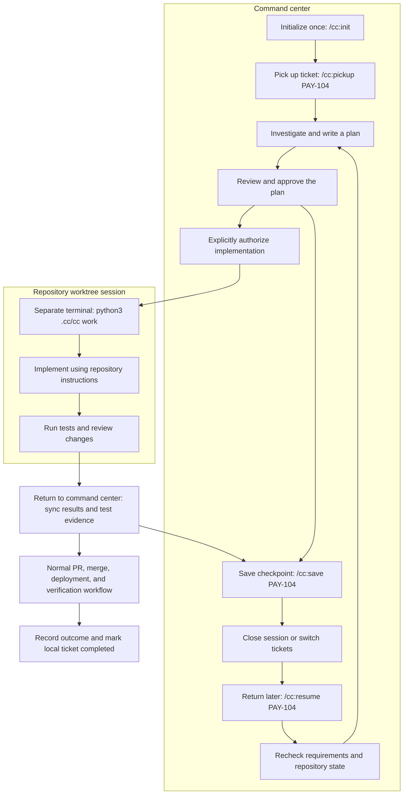

# My CC

**Engineering-first, local-first command centers for Claude Code.** Save Jira ticket plans and decisions, pause for days or weeks, resume from durable checkpoints, and launch coding sessions inside the correct repository/worktree so repository-specific instructions remain relevant.

**Version:** `0.1.1` (starter). **Maintainer:** [Kevin Cabrera](https://github.com/cabrerakevinc).

> This project is an independent Claude Code plugin and local Python utility. It is not affiliated with Anthropic, Atlassian, or AWS.

## Install via Claude Code marketplace (recommended)

In Claude Code, run:

```text
/plugin marketplace add cabrerakevinc/my-cc
/plugin install cc@my-cc-marketplace
```

The marketplace commands work **after** this repository has been pushed to GitHub. For local development before pushing:

```bash
cd /Users/kevincabrera/Code/my-cc
claude plugin validate ./plugins/cc
claude plugin validate .
claude plugin marketplace add /Users/kevincabrera/Code/my-cc
claude plugin install cc@my-cc-marketplace
```

Then create and enter a fresh, empty workspace:

```bash
mkdir -p ~/work/bbc/command-center
cd ~/work/bbc/command-center
claude
```

Inside Claude Code invoke **`/cc:init`**. Plugin skills are namespaced, so the plugin's initializer is `/cc:init`, not the built-in `/init` and not the global `/cc-init` from the optional legacy installer. It initializes a workspace with a local, self-contained CLI at `.cc/cc`.

Outside Claude Code, use the generated CLI:

```bash
cd ~/work/bbc/command-center
python3 .cc/cc doctor
python3 .cc/cc pickup PAY-104 --title 'Sample task' --sprint DEMO
python3 .cc/cc checkpoint PAY-104 --summary 'Investigated' --next 'Plan and review' --pause
python3 .cc/cc resume PAY-104
```

Plugin commands are `/cc:init`, `/cc:pickup`, `/cc:save`, `/cc:resume`, `/cc:status`, `/cc:work`, and `/cc:draft`.

To migrate an existing plugin installation, uninstall `my-cc@my-cc-marketplace`, update the marketplace, install `cc@my-cc-marketplace`, and restart Claude Code. Existing workspace files and ticket state remain usable.

The independent workspace also has non-namespaced local `/cc-*` skills, plus the plugin's `/cc:*` skills. You can continue using native Claude Code `/plan` and `/code-review` unchanged.

## A ticket from pickup to delivery

Imagine **PAY-104: prevent duplicate charges when a payment request is retried**. Keep the requirements, plan, and handoff in your command center. Implement and test the change in a separate repository session.



Checkpoint whenever you stop, get blocked, or switch tickets. Resume restores the saved context; you choose the appropriate next step after checking what changed. The loop through planning represents that review, not a requirement to rewrite an unchanged plan.

### 1. Pick up and understand the ticket

After initializing an empty workspace with `/cc:init`, use these prompts **inside its Claude Code session**:

```text
/cc:pickup PAY-104
Investigate why retries can create duplicate charges. Capture the verified
acceptance criteria, affected repository, findings, and open questions.
Propose a plan before making implementation changes.
```

Jira lookup requires your approved TWG setup. Without it, supply the verified ticket details yourself. The terminal equivalent creates a local record without contacting Jira:

```bash
cd ~/work/bbc/command-center
python3 .cc/cc pickup PAY-104 --title 'Prevent duplicate charges on retry' \
  --summary 'Investigate whether repeated requests can charge a customer twice'
python3 .cc/cc phase PAY-104 investigating
```

Claude should identify the relevant code and propose a scoped plan with tests. For example: reuse the existing idempotency record and test repeated requests with the same key. Treat that as a hypothesis until investigation confirms it fits the repository.

### 2. Review the plan, then save a stopping point

Have Claude write the proposed plan to `pay-104-plan.md` in the command-center workspace. Review it, then run these commands **in a terminal from that workspace**:

```bash
python3 .cc/cc plan PAY-104 --file pay-104-plan.md
# Record approval only after you have reviewed and accepted the plan.
python3 .cc/cc approve PAY-104 --plan
python3 .cc/cc decision PAY-104 --text 'Reuse existing idempotency records' \
  --reason 'The reviewed approach avoids a second persistence mechanism'
python3 .cc/cc checkpoint PAY-104 --summary 'Plan reviewed and approved' \
  --next 'Recheck requirements and authorize implementation' --pause
```

You can also ask `/cc:save PAY-104` in Claude Code to distill the current facts, decisions, and next action into a checkpoint. Checkpoints are explicit; closing Claude alone does not save the conversation as a ticket handoff.

### 3. Resume tomorrow or next week

Open Claude Code in the same command-center directory:

```text
/cc:status
/cc:resume PAY-104
```

Claude reads the ticket's saved plan, decisions, and handoff. Recheck acceptance criteria and repository changes, then continue. These terminal commands inspect the same local state and explicitly clear the pause flag:

```bash
python3 .cc/cc resume PAY-104
python3 .cc/cc checkpoint PAY-104 --unpause --next 'Authorize implementation'
```

`resume` is read-only. If the plan changes, save it again with `plan --file` and obtain fresh approvals; replacing a plan resets both approval flags.

### 4. Authorize and launch implementation

After explicitly approving implementation, run the launcher from a **separate terminal**, while your coordinator session can remain open:

```bash
cd ~/work/bbc/command-center
python3 .cc/cc approve PAY-104 --implementation
python3 .cc/cc repo add payment-service ~/work/bbc/repositories/payment-service
python3 .cc/cc work PAY-104 --repo payment-service --dry-run
python3 .cc/cc work PAY-104 --repo payment-service
```

This assumes `payment-service` is already cloned at that path. `/cc:work PAY-104` can help prepare the launch, but run the actual interactive launcher in the separate terminal. It opens Claude Code in an isolated Git worktree with the approved work order. Implement there, follow the repository's instructions, and run its relevant tests. Both plan approval and implementation authorization are required before launch.

### 5. Bring the evidence back and continue delivery

After the repository session exits, return to a terminal in the command center. The launcher records Git state automatically on normal exit; record the implementation summary and actual test evidence explicitly:

```bash
python3 .cc/cc sync PAY-104 --repo payment-service \
  --summary 'Describe the changes actually implemented' \
  --tests 'Record the commands run and their actual results'
python3 .cc/cc phase PAY-104 in-review
python3 .cc/cc checkpoint PAY-104 --summary 'Implementation ready for review' \
  --next 'Review changes and prepare the PR' --pause
```

Replace the example summary and test text with verified results. `sync` records what you report; it does not run tests. Use `/cc:draft PAY-104` to help draft a reviewer or stakeholder update from the saved facts.

Continue PR creation, review, merge, deployment, and verification through your normal approved tools. Record the PR link and outcome in the ticket handoff. When delivery is verified, update local state:

```bash
python3 .cc/cc phase PAY-104 completed
python3 .cc/cc checkpoint PAY-104 --unpause \
  --summary 'Record the verified delivery outcome and PR link' --next 'No further action'
```

Local phases do not update Jira. PR creation, merge, deployment, and Jira transitions remain separate actions.

### What survives between sessions?

| Saved item | Purpose |
| --- | --- |
| `state/tickets/PAY/PAY-104/brief.md` | Verified requirements and acceptance criteria |
| `plan.md` and `decisions.md` in that ticket folder | Approach, constraints, and rationale |
| `handoff.md` and `ticket.json` in that ticket folder | Latest checkpoint, phase, approvals, and next action |
| `work-orders/` and `work-results/` in that ticket folder | Repository work orders, Git state, and reported test evidence |
| `state/index.sqlite` | Rebuildable index for ticket status queries |

These files live in the command-center workspace. Implementation changes live in the repository worktree. Keep the workspace and its state when closing Claude or switching tickets; a new empty workspace has its own independent history.

## Work in a repository, not in the command center

Plan tickets and preserve decisions from the command center. After approving a plan and implementation, run the *actual coding launcher in a separate terminal*:

```bash
cd ~/work/bbc/command-center
python3 .cc/cc repo add payment-service ~/work/bbc/repositories/payment-service
python3 .cc/cc work PAY-104 --repo payment-service --dry-run
python3 .cc/cc work PAY-104 --repo payment-service
```

The launcher creates/reuses an isolated worktree and starts a separate Claude Code conversation from that repository. It calls out applicable `AGENT.md` (singular), `AGENTS.md`, and `CLAUDE.md` instructions; do not assume the singular name is automatically loaded. **Repository engineering conventions govern implementation.** The approved ticket plan governs requirements; if they conflict, Claude must stop and ask.

## Reusable workspaces and persistent context

Use the same plugin to create `~/work/bbc/command-center`, `~/work/bevz/command-center`, or `~/school/mba/command-center`. Each stores its own per-ticket state, SQLite index, `handoff.md`/`decisions.md`/`plan.md`, and business/communication profiles. Workspace `state/` and `context/` are gitignored; verify company policy before syncing work material.

## Integrations and limitations

- **TWG CLI**: intended Atlassian (Jira/Bitbucket/Rovo) integration, but commands are not wired until inspected on the company machine.
- **AWS MCP CLI**: intentionally not automatically configured; follow company authorization and use read-only diagnostics as appropriate.
- **Context7**: reuse the user's existing MCP setup, no auto-install.
- **Release v0.1.0**: local persistence, workspace initialization, repository launching, and skills. **No automatic Jira fetch, PR creation, merge, deploy, or Jira state transitions yet.**
- Python 3.10+ and Git required. Claude Code required for interactive coding; Python CLI uses standard library only.
- Plugin installation does not modify user shell configuration. Optional `./install.sh` installs a global `cc` CLI and unprefixed global `/cc-init`, but is **not necessary** for the marketplace plugin.

Full CLI walkthrough: [docs/CLI-REFERENCE.md](docs/CLI-REFERENCE.md). Quick start: [QUICKSTART.md](QUICKSTART.md). Release notes: [v0.1.1](docs/releases/v0.1.1.md).

## Development and validation

```bash
python3 -m unittest discover -s tests -v
python3 scripts/validate_package.py
claude plugin validate ./plugins/cc  # requires Claude Code CLI
claude plugin validate .                 # requires Claude Code CLI
```

## Publishing

Follow [docs/RELEASING.md](docs/RELEASING.md) to push to `git@github.com:cabrerakevinc/my-cc.git`, tag the next unpublished version, and create a GitHub Release. A local tag or ZIP is **not** evidence of a published GitHub Release.

## License

No open-source license is granted by default. The maintainer can add an explicit license before encouraging external redistribution or contributions.
